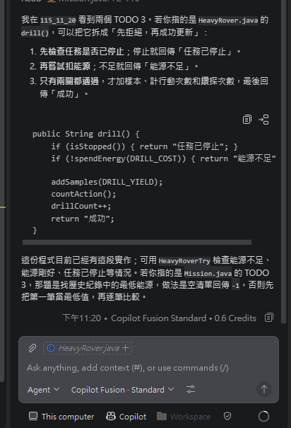

# 第七週AI使用紀錄

本範本由Codex生成。另存當日日期目錄AI_USAGE.md，刪除虛構範例後填本人紀錄。沒有使用真實AI也交，來源註明教師模擬，並填本人驗證；未完成就寫待補。

姓名／學號：楊子奇/A113230008
工具及來源：copilot/HeavyRover.java

## 精簡紀錄

| 使用目的與Prompt摘要（註明來源） | 採納／拒絕與理由 | 本人驗證：預期、實際、證據位置 | 最終修改與commit |
|---|---|---|---|
| 【虛構填寫示範，非本人實測】教師模擬HeavyRover，父類別欄位private就再宣告一份 | 拒絕：getter讀父類別狀態，drill卻改另一份 | 示範情境：預期鑽探後12/3/1/1，錯誤版卻20/0/0/1；完整紀錄應引用LAB_REPORT E | 示範：刪重複欄位、用protected方法、補停止與計次，再重測；填本人的[AI]與[fix]commit |
| TODO3應該如何開始寫 | 採納:AI 給的判斷順序跟寫法滿清楚的 | 預期：已停止（樣本>=5 或能源=0）呼叫 drill() 回「任務已停止」，能源<8 回「能源不足」且不改狀態；通過才扣 8 能源、加 3 樣本、行動與鑽探數各 +1。實際：跑 HeavyRoverTry.java 測正常鑽探（12/3/1/1）、能源不足（7/0/0/0）、剛好足夠（0/3/1/1）、零能源與已達標（0/0/0/0、20/5/0/0），全部「相符」。證據位置：HeavyRoverTry.java 執行結果 | HeavyRover 補上鑽探次數和 drill() 判斷、Rover 完成 spendEnergy() 扣能源，跑 HeavyRoverTry 測過沒問題。 |

真實AI對話另列一行，寫工具與採納理由，不把模擬回覆當成真實對話。記錄可引用LAB_REPORT的完整輸出，不重抄十五行。不得上傳個資、帳號密碼或未授權程式。
AI對話:

## 反思

- 哪個案例讓我發現「回成功卻沒更新正確狀態」：「一開始在測 HeavyRoverTry 的第一個正常鑽探（預期 12/3/1/1）時，如果漏寫 countAction() 或 drillCount++，方法雖然會回傳『成功』，但後面的行動次數或鑽探次數不會跟著加 1。
- 我保留或拒絕AI建議的理由：和老師上課做的程式相符。
- 我仍無法解釋或尚未完成的部分：不清楚commit要填什麼。
